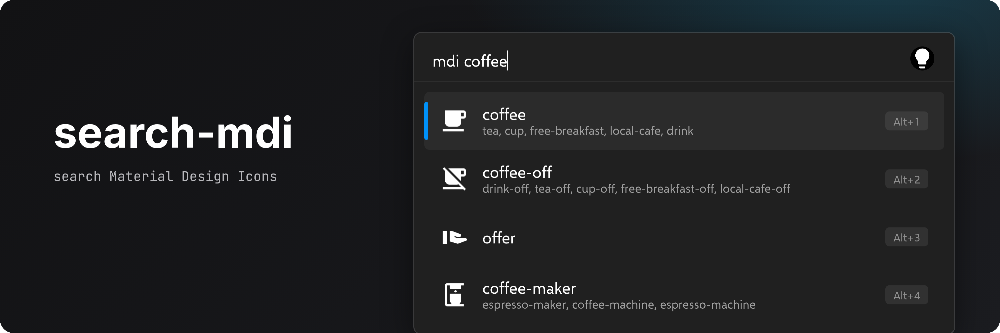

<!-- generated by readwright from docs/README.md.j2; edit the template, not this file -->


# Search-MDI

Search Material Design Icons from Flow Launcher and copy their names.

[](https://github.com/Garulf/Search-MDI/actions/workflows/tests.yml) [](https://github.com/Garulf/Search-MDI/releases/latest) [](https://github.com/Garulf/Search-MDI/releases/latest)

[](https://www.buymeacoffee.com/garulf) [](https://github.com/sponsors/Garulf)

## Features

* **Works offline.** The [Material Design Icons](https://pictogrammers.com/library/mdi/) set (6,595 icons, up to MDI 6.5.95) ships with the plugin. No web requests while you search.
* **Real icons in the results.** Each result shows the icon itself, drawn from the bundled font.
* **Matches aliases too.** `mdi house` finds `home`, `mdi cup` finds `coffee`.
* **Copy on Enter.** The icon name, such as `home`, goes straight to your clipboard.

## Usage

Type `mdi` followed by part of an icon name or alias:

```
mdi github
```


Press `Enter` to copy the icon name to the clipboard.

### Context menu

Open the context menu (`Shift+Enter` or right-click) and choose **View icon on website** to open the icon's page
on pictogrammers.com:


## Installation

### Flow Launcher

In Flow Launcher, type:

```
pm install search-mdi
```


### Manual installation

Download `Search-MDI-<version>.zip` from the [latest release](https://github.com/Garulf/Search-MDI/releases/latest) and unzip it into
`%appdata%\FlowLauncher\Plugins`, then restart Flow Launcher.

Pre-releases of the next version are published from the open release PR on the
[releases page](https://github.com/Garulf/Search-MDI/releases) for testing. Flow Launcher won't offer them as updates.

## Requirements

* Flow Launcher 1.17.0 or newer
* Python 3.8 or newer, which Flow Launcher can install for you

## Changelog

### [3.0.3](https://github.com/Garulf/Search-MDI/releases/tag/v3.0.3) - 2022-01-13

- Update Flox by @Garulf in https://github.com/Garulf/Search-MDI/pull/18

### [3.0.1](https://github.com/Garulf/Search-MDI/releases/tag/v3.0.1) - 2022-01-02

- Handle auto complete by @Garulf in https://github.com/Garulf/Search-MDI/pull/17

### [3.0.0](https://github.com/Garulf/Search-MDI/releases/tag/v3.0.0) - 2022-01-02

- Use material design fonts by @Garulf in https://github.com/Garulf/Search-MDI/pull/16

See [CHANGELOG.md](CHANGELOG.md) for the full history.
